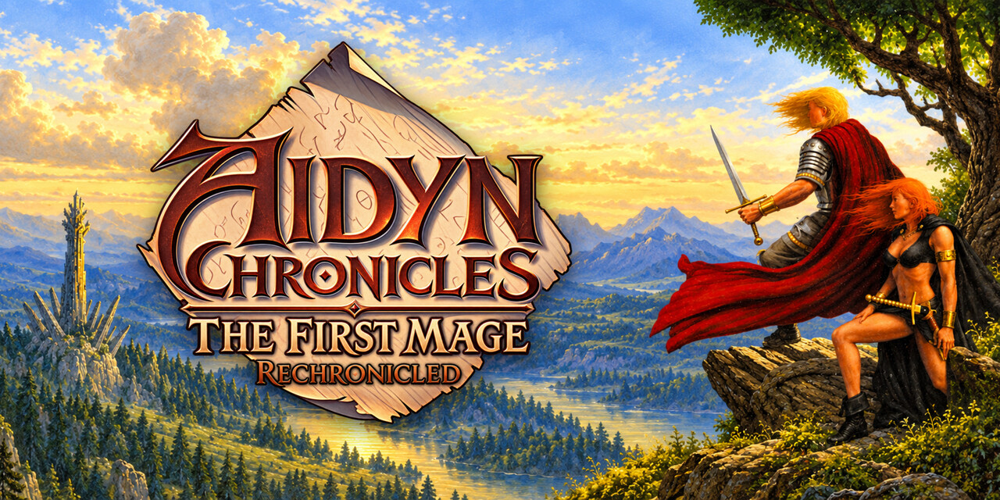
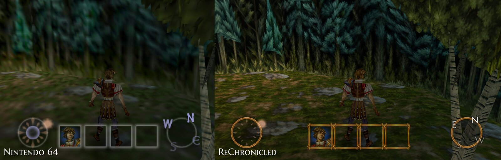
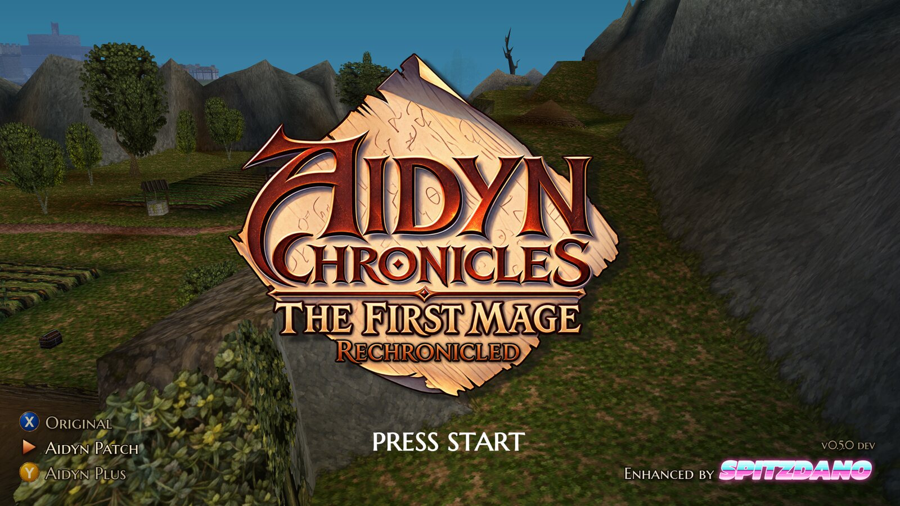
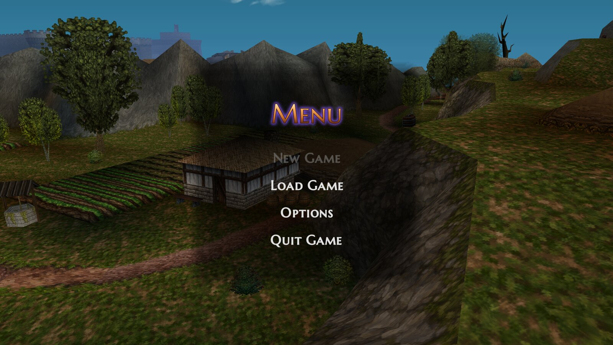
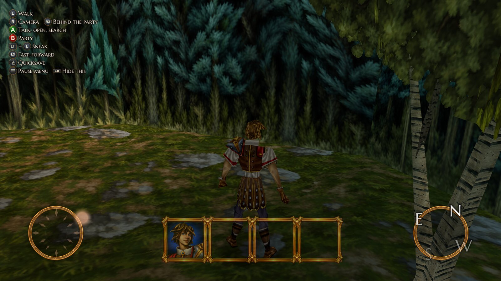
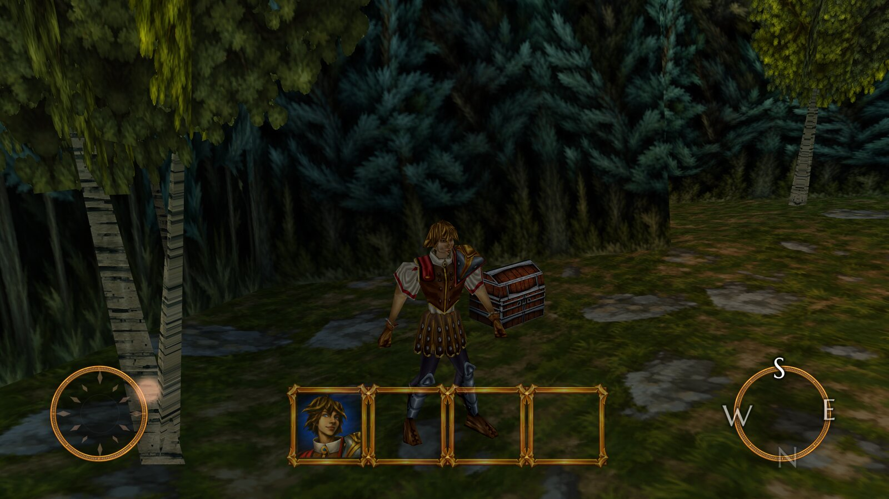
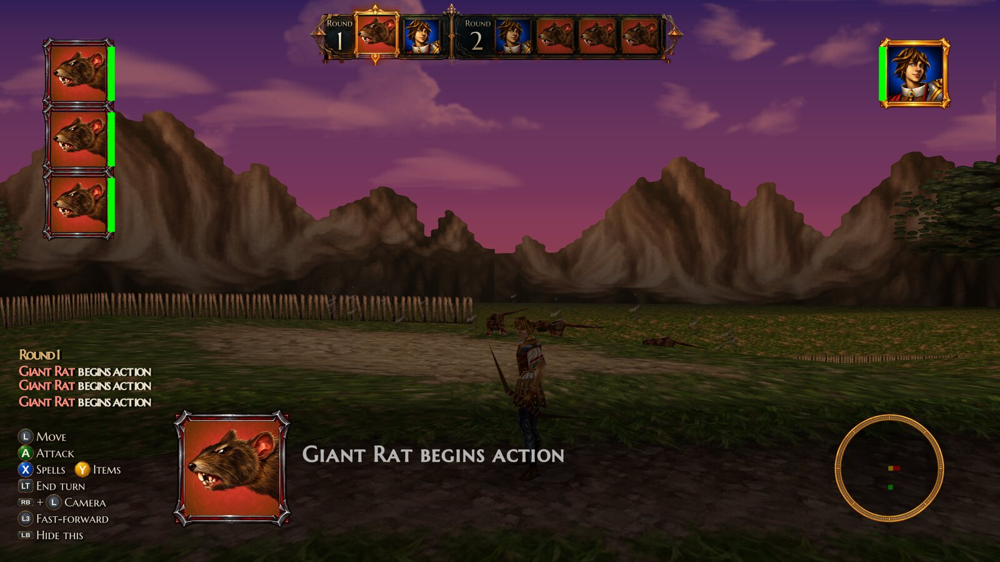
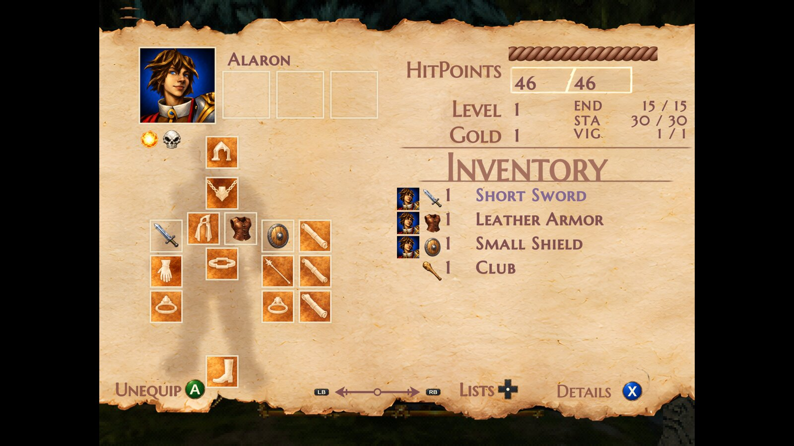
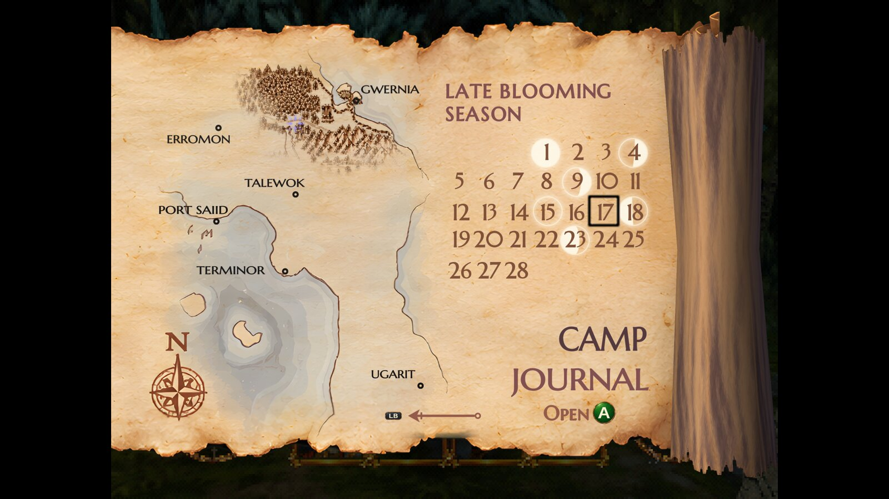
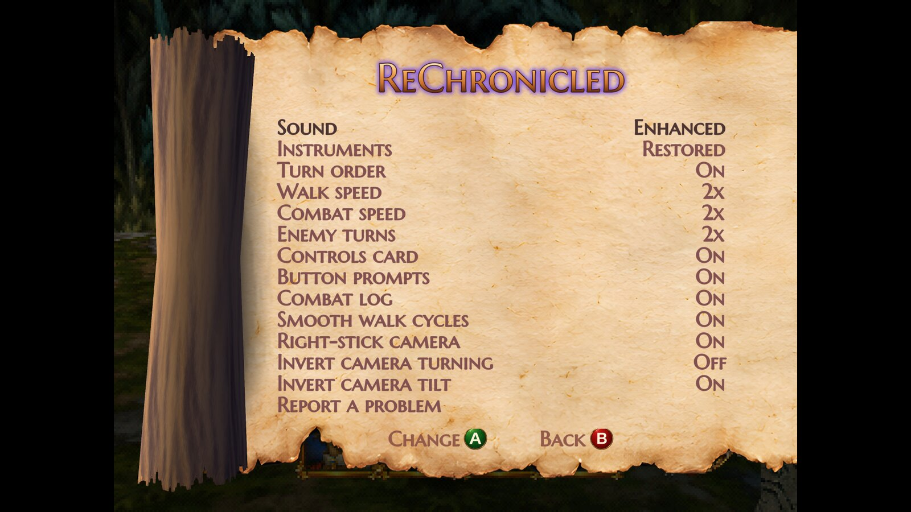

# Aidyn ReChronicled

*Aidyn Chronicles: The First Mage* (NTSC-U 1.0), enhanced by Spitzdano: a native Linux and Windows build of *AIDYN_CHRONICLES*
(NAYE, version 0), made by static
recompilation with [N64Recomp](https://github.com/N64Recomp/N64Recomp) and run on
[N64ModernRuntime](https://github.com/N64Recomp/N64ModernRuntime) with the
[RT64](https://github.com/rt64/rt64) renderer.



## Features

- **A native game for Linux and Windows**, not an emulator. Linux: one download for any current distribution, with an
  installer that adds it to the app menu and to Steam (Steam Deck and ROG Ally friendly). Windows: a folder to unpack
  and play (Windows 10 or 11, nothing to install), with an Add to Steam button.
- **Your ROMs in one folder**: put the 1.0 ROM, and the Aidyn Patch and Aidyn Plus ones if you have them, in the
  download's `ROMs` folder under any names; the game tells them apart by their contents and lists what it found on the
  title screen.
- **Aidyn Patch and Aidyn Plus**: halibabica's community rebalances play as two more versions next to the original.
  Bring your own patched ROM (checked by its hash; nothing of either patch ships here), switch on the title screen, and
  each version keeps its own saves.
- **Sharp at any resolution**: drawn at 1080 lines or more, supersampled, with anti-aliasing.
- **Widescreen**: 16:9, 21:9 or any width, with the HUD at the screen edges; the menus stay 4:3, as they were made.
- **Smooth**: the game runs at 60 frames a second (the N64 managed 15 to 20), with frames drawn in between up to your
  display's rate, and walk cycles without their stutter.
- **Newly painted art**: 2,113 of the game's 2,115 world textures, every portrait, an icon of its own for every item
  (each potion its own colour, scrolls and wands by school), the HUD, the map page's land and a repainted pause scroll,
  plus HD lettering and Xbox button prompts. F2 shows what was there before.
- **Fuller sound**: the game's music and sounds as loud as other games' (they played very softly) and a little
  clearer, through a limiter; the same music and sounds, switchable back to the original.
- **Further draw distance**: more of the land drawn, trees and objects showing from much further away.
- **A free camera** on the right stick, kept out of walls.
- **Quicksave, autosaves, Quick Load and Continue**, in files of their own beside the Controller Pak.
- **Fast-forward** (3x) and a **faster walk** (1.5x by default, up to 2x).
- **Clearer combat**: a turn-order bar, a combat log, framed portraits, easier aiming, and what a spell or potion does
  shown while you choose it.
- **Help built in**: a controls card on screen, button hints in the menus, a ReChronicled topic in the help book and a
  PC edition of the manual (F1).
- **Changed while you play**: the Display and ReChronicled pages of the pause menu hold all of this edition's options,
  windowed or borderless full screen included.
- **Safe saves**: the Controller Pak's last 20 states are kept, an emulator's save (Project64, ares, Mupen64Plus,
  RetroArch) can be copied in, and a problem report gathers what's needed when something goes wrong.

**This repository contains no game data** (only the pictures on this page). You need your own dump of the game. The build
checks it against this SHA-1:

```
47ae795a2b12783a13e2b8d03439ce9a39fc826c  baserom.z64
```

> **Work in progress.** This is a hobby project I'm making for myself, in my own time. Expect rough edges, unfinished
> parts and changes between releases, and no schedule. For lack of time I haven't played very far into the game yet,
> so playtests and problem reports from further along are very welcome (see [Found a problem?](#found-a-problem));
> I'll work on them when I can.

> **Unofficial fan project.** Not affiliated with or endorsed by THQ, H2O Entertainment or Nintendo. *Aidyn
> Chronicles: The First Mage* and its characters, art and music belong to their rights holders.

> **Made with heavy AI involvement.** Nearly all of the code, tools and documentation here were written by an AI
> coding assistant (Claude Code), directed and play-tested by Spitzdano. The redrawn portraits, icons and world
> textures in `art/` were made with an AI image generator from the game's originals, each checked against its
> original; the HD menu and world texture packs are AI upscales (Real-ESRGAN) of the game's own pictures. Scaffolded
> by the n64-recomp-toolkit's `new-game.sh`.

## Screenshots



| | |
|---|---|
|  |  |
| The redesigned title card, and the version switch | Continue picks up from your newest save |
|  |  |
| The new HUD, the controls card, widescreen | Newly painted world textures and portraits |
|  |  |
| The turn order bar, framed portraits and the combat log | The repainted scroll, HD lettering and Xbox prompts |
|  |  |
| The map page's calendar with its moon phases | This edition's options, changed while you play |

## Download and play

[Releases](https://github.com/spitzdano/AidynReChronicled/releases) have ready-to-run builds:

- **Linux** (`AidynReChronicled-<version>-linux-x86_64.tar.gz`: x86_64, glibc 2.38 or newer, a Vulkan driver). Unpack
  it and run `bash install.sh` (app menu entries and, if wanted, a Steam shortcut) or `game/aidyn-rechronicled.sh` in
  place.
- **Windows** (`AidynReChronicled-<version>-windows-x86_64.zip`: Windows 10 or 11, 64-bit, a Vulkan driver; the
  Visual C++ runtime is included, nothing to install). Unpack it anywhere and run `AidynReChronicled.exe`;
  `Add to Steam.bat` adds it to Steam with its library art.

**Your ROMs:** put them in the download's `ROMs` folder: the NTSC-U 1.0 ROM, and the same ROM with Aidyn Patch or Aidyn
Plus applied if you have them, under any names (`.z64`, `.n64` or `.v64`). At each start the game looks there for any
version it doesn't have yet, recognises each by its hash, keeps a copy in its data folder and lists it on the title
screen; on Linux, `install.sh` copies them to the installed game's `ROMs` folder and keeps that folder through updates.
If the version you played last has no ROM, the game plays one that has. Without any ROM there, the first start asks for
one in a file dialog. The README in the download covers controls, Aidyn Patch, Aidyn Plus and settings, and
RELEASE-NOTES.md what each release changed (`tools/release/notes`). Releases carry
no game data (nor either patch), and not the HD menu and world texture packs; the newly painted art, the HD letters and
the title branding ship as three `.rtz` texture packs.

The data folder (settings, saves, logs, problem reports, the stored ROMs) is `~/.local/share/AidynReChronicled` on Linux
and `%APPDATA%\AidynReChronicled` on Windows.

A release is made with `tools/release/make_release.sh <version> --windows --publish`: it builds the portable Linux
executable (`tools/ally/build_portable.sh`) and the Windows one (`tools/windows/build_windows.sh`, cross-compiled
here), packages each with its launcher or Add to Steam script, the icon, the Steam art and the texture packs, tags the
pushed `main` and creates the GitHub release with both.

## Found a problem?

Please report it: a crash, a freeze, a glitch, a wrong picture, anything that looks off.

1. **Make a problem report.** If the game crashed, it already made one and said where. Otherwise pause as close as you
   can to the problem and choose **Report a problem** at the bottom of the **ReChronicled** page (on the pause
   menu's Menu page): it also keeps a picture of the screen and a save of that moment.
2. **Open an issue** with the [Problem report form](https://github.com/spitzdano/AidynReChronicled/issues/new?template=problem-report.yml) and drag in the newest `.zip` from
   `~/.local/share/AidynReChronicled/reports` on Linux (on a Steam Deck or an Ally, switch to Desktop Mode to reach
   it) or `%APPDATA%\AidynReChronicled\reports` on Windows (type that into File Explorer's address bar).
3. **Say what happened** and what you were doing just before.

A report holds the game's logs, your settings and your saves, nothing from the game's ROM, and your home folder's
name is left out of it.

## Building

Building it yourself isn't supported: play the [releases](https://github.com/spitzdano/AidynReChronicled/releases).
For the record, a release is built from this repository and the
[n64-recomp-toolkit](https://github.com/spitzdano/n64-recomp-toolkit) at commit `e1e4e40`, cloned and built on the
machine (`install.sh`, `build.sh`, `doctor.sh`). `tools/toolkit.env` says where it is (`~/Work/n64-recomp-toolkit`); set
`N64RECOMP_TOOLKIT` to override.
The redrawn art (`art/`) is a submodule from its own private repository; players get it in the releases' texture
packs.

```sh
git submodule update --init --recursive
ln -s /path/to/your/dump.z64 baserom.z64   # never copied, never committed

tools/split.sh        # splat: split/asm, split/bin, linker script
tools/build_elf.sh    # assemble + link -> build/aidyn.us.elf; must rebuild baserom.z64 byte for byte
tools/recomp.sh       # N64Recomp -> RecompiledFuncs/, RSPRecomp -> rsp/
tools/check_recomp.sh # compile-only check of the generated code
```

Everything under `split/asm`, `split/bin`, `RecompiledFuncs/`, `rsp/` and `build/` is derived
from the ROM, so it is gitignored and regenerated by the commands above.

The Windows build is cross-compiled on Linux: `tools/windows/build_windows.sh` (clang-cl and lld-link against
Microsoft's C runtime and Windows SDK, fetched by a pinned [xwin](https://github.com/Jake-Shadle/xwin); Vulkan, as on
Linux) puts the exe and its DLLs in `build/windows/dist`. It is tested under GE-Proton
(`tools/dev/windows-steam.sh` adds it to Steam on the Linux PC) and on Windows.

## Stubs, ignored functions and patches

Every entry in `aidyn.us.toml`'s `[patches]` and every hand-written stub in `src/` is listed
here with the reason for it.

| Function | Kind | Why |
|---|---|---|
| func_800B7B50, func_800B7BC0, func_800B7C6C, func_800B7C88, func_800B7CBC, func_800B7D40, func_800B81C8, func_800B828C | stub (`aidyn.us.toml`) | libultra exception machinery (cop0, cache ops, handler vector); ultramodern provides interrupts and threads |
| osPfsInitPak, osPfsFreeBlocks, osPfsAllocateFile, osPfsDeleteFile, osPfsFileState, osPfsReadWriteFile, osPfsRepairId, osPfsFindFile, __osCheckId, __osCheckPackId, __osGetId, __osPfsCheckRamArea, __osPfsRWInode, __osPfsSelectBank, __osRepairPackId | renamed `aidyn_*` (`tools/symbol_renames.txt`) | N64Recomp substitutes the runtime's "no Controller Pak" versions for these names. Renamed, the game's own libultra file system is recompiled and runs over the pack image below |
| Graphics__EndList | ignored; `src/game/patches.cpp` | ends each frame's display list; the C version draws the game's black CRT-overscan frame only when `overscan_borders` is on (it would sit in the middle of a 16:9 picture) |
| func_800A68E0 | ignored; `src/game/patches.cpp` | the walking camera's "behind the player" point; the C version keeps the camera's own direction after the right stick has turned it |
| func_800AA2B0 | ignored; `src/game/patches.cpp` | Font::GetButtonColor; white while the HD UI pack is loaded, so its Xbox button icons keep their colours |
| __osSiGetAccess/RelAccess, __osSpDeviceBusy, __osGetSR, osUnmapTLBAll | ignored by N64Recomp (runtime-provided) | the runtime lacks `__osSiGetAccess/RelAccess`, `__osSpDeviceBusy`, `__osGetSR`: stubbed in `src/game/stubs.cpp` |
| osPfsIsPlug, __osPfsGetStatus, osPfsChecker, __osContRamRead/Write | `src/game/pak.cpp` | the Controller Pak (below) |

## Controller Pak saves

The game keeps its saves on a Controller Pak. `src/game/pak.cpp` emulates one pack in port 1 as a 32 KiB image in the standard
libultra layout, `~/.local/share/AidynReChronicled/aidyn.mpk` (`AIDYN_MPK=/path` overrides it). Only the two raw block accesses
(`__osContRamRead` / `__osContRamWrite`, 32 bytes each) plus the PIF-level `osPfsIsPlug`, `__osPfsGetStatus` and `osPfsChecker` are
ours; the file system on top (ID and inode tables, note directory, free-page accounting, the `PFS_ERR_*` codes) is the game's own libultra
code, recompiled. A new image is created formatted (as `osPfsReFormat` leaves one). Every write is flushed at once through a temp file and a
rename. An existing file must be exactly 32768 bytes (Project64's `.mpk` and ares' `.pak` work as they are), or a file holding four
controllers' packs, which is converted when the game starts: Mupen64Plus' 128 KiB `.mpk` (RMG, simple64) and RetroArch's `.srm`
(Mupen64Plus-Next, ParaLLEl-N64). The pack with an Aidyn save (else the first formatted one) becomes the 32 KiB file and the original
is kept in `backups/`. Anything else stops the program and is left untouched.
Ports 2 to 4 report no pack. `osPfsChecker` always reports "consistent": it talks to the PIF directly.

Runtime-shell stubs (`src/game/stubs.cpp`): `__osSiGetAccess` / `__osSiRelAccess` (no-op), `__osSpDeviceBusy` (never busy), `__osGetSR`
(context status register), and `aidyn_park_boot_thread` (hooked at the entrypoint's trailing `break`: bootproc returns on the runtime but
never on hardware). `src/main/audio.cpp` caps the reported audio queue at one VI so the game's unsigned buffer-size arithmetic can't wrap.

Split fix-ups (all in `tools/`, applied by `tools/split.sh`; `decomp/` is never edited): `yaml_options.txt` + `yaml_fixes.txt`
(segment boundary moves and replacements), `symbol_fixes.txt` (named/sized symbols), `symbol_fixes_auto.txt` (functions reached only
through data, from `find_missing_funcs.py`), `symbol_drops.txt` (bogus decomp symbols inside other functions), `symbol_renames.txt` (see above). `find_fallthrough.py` must
report 0: a function that falls off its end into the next one is recompiled as a function that returns early and leaves the stack pointer wrong.

## Running

```sh
cmake -S . -B build/cmake -G Ninja -DCMAKE_BUILD_TYPE=Release -DCMAKE_C_COMPILER=clang -DCMAKE_CXX_COMPILER=clang++
cmake --build build/cmake --target AidynReChronicled
build/cmake/AidynReChronicled --rom /path/to/aidyn-chronicles-ntsc-u-1.0.z64    # remembered after the first run
```
F1: the manual. F2: the redrawn art (`rechronicled-art` pack) off and on, to compare ("Redrawn art off" shows top right while it's off). F11 / Alt+Enter (or the Display page's Window row): windowed or borderless, remembered. Shift+Esc: quit. The game starts at the title screen (`skip_intro`). Data (settings, saves, the stored
ROMs, texture packs) lives in `~/.local/share/AidynReChronicled` (Windows: `%APPDATA%\AidynReChronicled`); ROMs put in
`ROMs` beside the executable (or one folder up) are found and stored at the start; a folder from the project's earlier name, `AidynRecompiled`, is moved
there on the first run.

**Aidyn Patch and Aidyn Plus.** Two community rebalances by halibabica (u/halibabica) can be played instead of the
original: Aidyn Patch and the bigger Aidyn Plus (2023: a massive overhaul that corrects many issues and makes the game
more challenging; new weapon skills and items, every spell learnable, elements and resistances reworked; read its FAQ).
Aidyn Plus first came out as a ROM download on a site that is gone; it now exists as a patch for the 1.0 ROM (SHA-1
`47ae795a...`, CRC32 `b1f18186`). Neither comes with this project: get the patch yourself and apply it to your own 1.0 ROM (for
Aidyn Plus, `AidynPlus.bps` with a BPS patcher such as Flips or Floating IPS), then run the game once with
`--rom /path/to/that.z64`, or put it in the `ROMs` folder. Each is checked by its hash and only a match is stored, next
to the original ROM:

| Version | XXH3-64 | SHA-1 |
|---|---|---|
| Original (NTSC-U 1.0) | `79127d0e9caf38bc` | `47ae795a2b12783a13e2b8d03439ce9a39fc826c` |
| Aidyn Patch | `aee228c7fb42f968` | `1f95ad78824f491ea3d94e3ac5d36901cef09e4e` |
| Aidyn Plus | `a72109e848aff75e` | `d57f9459a77c66490ff09b3d9d97545c7a65fad2` |

Both change only game data (potion recipes and prices, skill and weapon XP rates, the entity, weapon, armour, spell,
item and chest databases; compared byte by byte with the 1.0 ROM), no code, so they run on the same recompiled code.
You can have none, one or both. Each game keeps its own Controller Pak: `aidyn-patch.mpk`, `aidyn-plus.mpk`; copy
`aidyn.mpk` over one to carry a save across (not into Aidyn Plus: its databases differ enough that such a save can
crash it, #31). Aidyn Plus's own FAQ warns that some of its items and spells freeze the
game when you look at their description; that is the romhack, not the port.

Switching versions:
- **Title screen**: the bottom left lists *Original*, *Aidyn Patch* and *Aidyn Plus*, the running one lit with a copper
  marker. The other two show X (keyboard K) and Y (keyboard I), the upper one X: pressing it saves the choice in
  `settings.json` and restarts the program in place into that version, back at the title. A version whose ROM isn't
  stored is grey and marked *not found*; if the version in `settings.json` is one of those, the game plays one whose
ROM is there instead, for that run, and lights that one. The list is on the title card: from the menu Start opens (New Game, Load Game,
  Options), B goes back to it (the game had no way back; `aidyn_title_back` calls its own `IntroMenu::InitTitleCard`).
- **Version number**: the bottom right of the title screen shows the build's version above the credit: "v0.4.0" for a
  release (`make_release.sh` passes it to the build as `AIDYN_VERSION`), "v0.4.0 dev" for a build after that tag (from
  `git describe`, `tools/version.cmake`, on every build).
- **Launch options**: `--original`, `--patch` or `--plus` picks the version for that run (otherwise `game.rom_patch`).
- **App launcher**: `tools/install-launchers.sh` adds "Aidyn ReChronicled" (`--original`), "Aidyn ReChronicled (Aidyn
  Patch)" (`--patch`) and "Aidyn ReChronicled (Aidyn Plus)" (`--plus`) to `~/.local/share/applications` (`--remove` takes
  them out).

| N64 | Xbox controller | Keyboard | In the game |
|---|---|---|---|
| Control stick | Left stick | Arrows | walk, move in combat, menus |
| (camera) | Right stick | | turn the camera around the party (left/right), tilt it up or down (up/down), both at the same speed, 30 degrees each way from its resting height; once turned, the camera keeps that direction while walking (`camera_invert_x` / `camera_invert_y` flip them) |
| (camera) | Right stick click | | camera back behind the party at its resting height (the original follow camera) |
| (fast-forward) | Left stick click | hold Tab | fast-forward on / off: everything runs `fast_forward_speed` times faster (3); a marker shows at the top right |
| A | A | Z | talk, open, confirm; in combat: attack, then act on the target |
| B | B | X | back, cancel; walking: show the party's portraits; title menu: back to the title card |
| C-down | X | K | Details (pause menu); in combat: spells (tap: the last spell again, hold + stick: pick one); title screen: switch to the version marked X |
| C-up | Y | I | in combat: items and potions (tap: the last one again, hold + stick: pick one); title screen: switch to the version marked Y |
| C-left | View | J | walking: quicksave; in combat: nothing (not passed to the game in either); pause menu: previous party member |
| C-right | RT | L | pause menu: next party member |
| Z | LT | C | walking: hold + stick to sneak; combat: end the turn; pause menu: previous page |
| L | LB | Q | walking and in combat: show / hide the controls card (not passed to the game there; in combat it was a second End turn); pause menu: previous page |
| R | RB | E | pause menu: next page; hold + stick: the game's own camera control |
| Start | Menu | Enter | pause menu; back to the game |
| D-pad | D-pad | keypad 8 4 5 6 | menus |

These are the game's own controls (from its 2001 instruction booklet) on the port's buttons; the manual has them per
screen.

**Handheld (Bazzite, ROG Xbox Ally X).** `tools/ally/` builds a copy that runs on other Linux systems (in a container,
glibc 2.38, its own SDL2), Steam art, and the installer that adds the game to Steam (the release README has the
steps, and how to add it by hand).

**Manual.** `tools/manual/build_manual.py` builds a PC edition of the instruction booklet (HTML and an A5 PDF) into
`~/.local/share/AidynReChronicled/manual`: new text following the original booklet's chapters, with the spell list,
portraits and icons read from your own ROM (and tables of what Aidyn Patch and Aidyn Plus change: spells, weapons,
armour, items, creatures, training and potions, when those ROMs are stored), and
screenshots from `tools/manual/shots.sh`. F1 in the game and the launchers' Manual action open it. See
`tools/manual/README.md`.

With the HD UI pack, the button icons in the game's text are drawn as these Xbox buttons.

### Settings

`~/.local/share/AidynReChronicled/settings.json` (Windows: `%APPDATA%\AidynReChronicled\settings.json`) is written with
these defaults on the first run:

```json
{
    "game": {
        "rom_patch": "none",
        "skip_intro": true,
        "fast_forward_speed": 3,
        "combat_enemy_speed": 2,
        "save_backups": 20
    },
    "audio": {
        "enhanced": true,
        "loudness_db": 18.0,
        "brightness_db": 6.0
    },
    "graphics": {
        "render_height": 1080,
        "aspect": "16:9",
        "widescreen": true,
        "msaa": 4,
        "supersampling": 2,
        "fps_limit": 240,
        "draw_distance": 3.0,
        "walk_speed": 1.5,
        "fullscreen": false,
        "menus_4_3": true,
        "right_stick_camera": true,
        "camera_invert_x": false,
        "camera_invert_y": true,
        "overscan_borders": false,
        "smooth_animation_loops": true,
        "textures": true,
        "vsync": true,
        "texture_packs": ["hd-ui", "hd-world", "rechronicled-text", "rechronicled-art", "rechronicled"]
    }
}
```

| Key | Values |
|---|---|
| `rom_patch` | `"none"` (the 1.0 ROM), `"aidyn-patch"` or `"aidyn-plus"` (see Aidyn Patch and Aidyn Plus above); the title screen's version list writes it |
| `skip_intro` | `false` puts back the start-up screens: Expansion Pak notice, copyright, Nintendo, THQ and H2O logos |
| `fast_forward_speed` | 2 to 6: how much faster the game runs while fast-forward (left stick click, held Tab) is on |
| `combat_enemy_speed` | 1 (off) to 6: enemy turns in combat run this much faster on their own |
| `enhanced` (audio) | `false`: the sound exactly as the game makes it. `true` (the ReChronicled page's Sound, Enhanced): louder, with a little more treble, through a limiter that holds the peaks at -1 dBFS (`src/main/audio.cpp`) |
| `loudness_db` (audio) | 0 to 24: how much louder Enhanced plays (the game's own mix measures -35 to -39 LUFS; +18 brings it to about -17 to -19, like other games) |
| `brightness_db` (audio) | 0 to 12: Enhanced's treble lift above about 3 kHz (the game's instrument samples have almost nothing above 4 kHz) |
| `save_backups` | how many copies of the Controller Pak to keep in `~/.local/share/AidynReChronicled/backups` (made at start and before each save; 0 = none) |
| `render_height` | internal resolution in lines: 1080 = 1440x1080 at 4:3 or 1920x1080 at 16:9; 0 = the largest multiple of 240 the window allows |
| `aspect` | `"4:3"` (original, bars at the sides); any wider `"width:height"` such as `"16:9"`, `"21:9"` or `"43:18"` (exactly 3440x1440): a wider 3D view, HUD and menus stay 4:3 in the middle; `"window"` (as wide as the window) |
| `widescreen` | `false`: 4:3, the N64's picture, whatever `aspect` says (the Display page's switch; turning it on with `"aspect": "4:3"` sets `"16:9"`) |
| `fullscreen` | `true`: borderless fullscreen on the display the window is on (F11, Alt+Enter or the Display page's Window row switch while playing, and save it); with `"aspect": "window"` the picture takes that display's shape (21:9 on an ultrawide). `AIDYN_WINDOWED=1` starts in a window whatever this says (`tools/dev/pad.sh` uses it) |
| `fps_limit` | frames shown a second, 30 to 1000, or 0 for the display's refresh rate; never above the display's rate (default 240: the display's own rate, up to 240). The game makes 60; above that RT64 draws in-between frames, interpolating the camera and every model (see below) |
| `msaa` | 0, 2, 4 or 8 |
| `supersampling` | 1 (off), 2, 3 or 4: renders at that many times `render_height` and scales down, smoothing the edges MSAA leaves (hair, leaves, thin parts). Not with `render_height` 0 |
| `draw_distance` | 1 (original) to 3: outdoors, rings of map cells beyond the game's own 3x3 are loaded and drawn (5x5 up to 9x9, 2 = 9x9: ground reaching about 400 units) and the far clip follows the loaded edge up to 180 x `draw_distance`; props (trees, rocks, objects) are drawn up to that many times farther, with their detail levels; monsters, people and items (chests, bags, herb patches) reach twice as far as props: 160 units at 2, 240 at 3 (originally 20 and 5 to 30) |
| `walk_speed` | 1 (original) to 2: in the field Alaron's walk and run cycles play this many times faster, and as the game moves him by them, his pace with them; nothing else is sped up (`1.5`) |
| `controls_card` | the card of button prompts at the left edge while walking (top) and in combat (bottom); LB shows and hides it and this remembers which (`true`) |
| `button_prompts` | the port's other button prompts: the menus' hints (Equip, Use, Lists, Take, Put back, Buy, Train, the combat menus' Choose / Release to use), LB and RB at the pause pages' arrows and the party switch beside the portraits (`false`: none; the controls card has its own switch) |
| `combat_log` | combat: the log of the fight at the bottom left (see "Combat log" below; `false`: none) |
| `fps_counter` | `true`: the frames shown a second at the top right (left of the fast-forward marker when that shows), over everything, in the game's font (the Display page; default `false`) |
| `turn_order` | combat: the round's turn order across the top of the screen, then the next round's (see "Turn order" below; `false`: none, and the game's own order within each speed group) |
| `hud_at_edges` | with a wider aspect: the time-of-day dial at the picture's left edge, the compass at its right edge; the party portraits stay centred (`false`: all in the middle 4:3, as the original) |
| `overscan_borders` | `true` puts back the black frame the game drew for CRT overscan |
| `right_stick_camera` | `false` turns the right-stick camera off |
| `camera_invert_x`, `camera_invert_y` | `true` turns the camera the other way left/right, or tilts it the other way up/down (inverted look) |
| `smooth_animation_loops` | `false` puts back the original stop in a walk or run cycle each time it loops (see below) |
| `textures` | `false`: every custom texture off, as the N64 drew it: the texture packs (HD menus, letters, buttons, portraits, world, title art), the HD save pictures and the redrawn page words; the letters go back to the game's own widths. The packs stay listed in `texture_packs` |
| `vsync` | `true`: each frame waits for the display's refresh (no tearing); `false`: shown as soon as it's drawn, for a G-Sync or FreeSync display (on a fixed-rate one it can tear) |
| `menus_4_3` | with `16:9` or `window`: the pause menu (all pages, also the combat inventory) and shop screens switch to 4:3 while they're up. Their layouts mix 2D draws that RT64 widens with ones it keeps centred, so the equipment page fell apart widened |
| `texture_packs` | RT64 texture packs in `~/.local/share/AidynReChronicled/texture-packs` (folders or `.rtz`), later ones win. The default `hd-ui` and `hd-world` are built by `tools/hdui` (see its README), `rechronicled-text` (the HD letters and Xbox buttons, drawn from fonts; it decides the letter widths, see "HD text") by `tools/hdui/text_pack.py`, `rechronicled-art` (the redrawn portraits and icons in `art/`) by `tools/hdui/art_pack.py`, `rechronicled` by `tools/branding/make_branding.py`; a missing pack is skipped with a message. A settings file from before `rechronicled-art` or `rechronicled-text` existed gets each added once |

**In the game.** The pause menu's Menu page has two more entries below Theater (in a battle, last), each a page of the
switches above that can change while playing: **Display** (`widescreen`, `textures`, `vsync`, `hud_at_edges`,
`draw_distance` from 1 to 3 in halves, and Anti-aliasing: `msaa` and `supersampling` together, Off 0 / 1, Low 2 / 1,
Medium 4 / 2, High 8 / 2, Ultra 8 / 3) and **ReChronicled** (`turn_order`, `walk_speed` from 1 to 2 in quarters,
`controls_card`, `button_prompts`,
`smooth_animation_loops`, `right_stick_camera`, `camera_invert_x` and `_y`, `combat_log`).
Up / down pick one, A or left / right change it, B goes back. Each change takes effect at once and is written into
`settings.json` (the rest of the file is kept); turning `textures` back on holds the game for a few seconds while the
packs load, as F2 does.

The game's own Options screen no longer has its Graphics row (Normal / High Resolution): the game always runs in the
normal mode. RT64 already renders at `render_height` in full colour, and the High Resolution mode's 512-wide frame only
stretched the HUD and menus off the side of the picture (its unused third mode, 32-bit colour, looked the same here).

The game itself submits a new frame every 1/60 s (its logic is delta-timed, so it simply runs at 60 fps here, where the
N64 managed 15 to 20). `AIDYN_FPS=1` prints the rate every two seconds. A file with a bad value stops the program with the
reason. On Hyprland, Omarchy's default window opacity lets the desktop show through; a rule like
`o.window("^AidynReChronicled$", { opacity = "1 1" })` makes the window opaque.

### Changes to the game's behaviour

All in `src/game/patches.cpp`, hooked from `aidyn.us.toml`:

- **Help book.** The pause menu's Help (a dialogue, `BORG13_HelpMenu`) is copied as it loads with its words fitted to
  this edition: the BUTTON after each button icon dropped (they're Xbox icons now), "the left stick" for the Control
  Stick, RT (not View, which quicksaves) to pick a target. A **ReChronicled** topic is added before Exit
  Help: the camera, fast-forward, the controls card, the menus, saving, combat (turn order, hold menus, D-pad targeting) and the
  keyboard and PC keys.
- **Pause scroll ends.** The pause pages are one long parchment drawn through a clip, and the scroll's rollers are a
  3D model moved sideways per page. On the Menu page the parchment ran on past the left roller to the screen's edge
  (and past the right one on the map page); the clip is now kept between the rollers' middles, which follow the page
  turns (measured in game; only with the pause menu at 4:3, `menus_4_3`).
- **Titles.** The pause pages' and menus' titles (Menu, Options, Theater, Pause, Enter Name) are drawn like the
  ReChronicled page's (`art/titles`), and the title card is Spitzdano's redesigned logo (`art/titles/source`, fitted by
  `tools/branding/make_logo.py`, with its shadow), RECHRONICLED included: the game's own "Rechronicled" under the card
  is drawn only while the redrawn art is off (F2, or textures off).
- **ReChronicled page.** The pause menu's list (`WidgetOptionsMenu::MakeScrollList`) gets one more entry, made the
  game's way (a `WidgetClipText` with its own id, appended to the scroll menu) after Theater, or at the end of a
  battle's shorter list. The scroll menu is made with room for exactly six entries and `Append` doesn't check, so its
  size is patched to eight (a seventh entry overran the array and hung the game when the pause menu was freed). The select callback would stop the game on an id it doesn't know, so it's hooked where it reads
  the id: ours opens the page instead. The page is drawn at the end of each frame over the parchment, with the list
  faded out beneath it (`Utilities::SetAlpha`) and the game given no input while it's up, so no button can reach the
  hidden list; it fades back when the page closes. Turning `textures` off reloads RT64's replacements with no packs
  (and no dynamic ones: the HD save pictures and redrawn page words) and puts back the fonts' original letter widths;
  `vsync` sets the swap chain's present mode, rebuilt at the next frame.

- **Pause menu edges.** The menu's opening reveal ends a few pixels short of the screen edges (a clip of 17..303 when it
  opens on the equipment page), hidden on a TV by overscan and the game's black border. It now finishes at the full
  width; before, the narrower clip also cut the journal page into texture strips the HD pack had no match for, so it
  showed the original parchment after paging to it from the equipment page.
- **Camera.** See the right stick above. The walking camera eases towards a point behind the party; after the right
  stick turns it, that point follows the camera's own direction instead (movement is relative to the camera, so a fixed
  angle from the party's facing would chase itself round). Tilting moves the height angle 30 degrees either way from
  where the camera rests (walking: -15 to 45); the game's own limits, 0 to 45, left only a third of that room upwards.
  `AIDYN_CAMERA_LOG=1` prints the angle.
- **Fast-forward.** Every mode measures its frame's time step by counting the controller samples queued since the
  last frame (1 to 6 ticks of 1/60 s, built for the N64's 10 to 20 frames a second). While fast-forward is on, each
  real sample is followed by quiet copies of it (same stick and held buttons, no new presses), so the game takes that
  many ticks a frame and no press is handled twice; enemy turns in combat get `combat_enemy_speed` the same way.
  `AIDYN_FPS=1` prints the game ticks a second (60, or 180 at 3x).
- **Save backups.** The Controller Pak is copied to `backups/` when the game starts and before each save (the first
  write after 30 s without writes), unless the copy would be the same as the newest one; the newest `save_backups`
  copies of each pak are kept.
- **Walk speed.** The game moves a character by its walk or run cycle (each animation step moves it as far as the
  cycle's root moves), stepping each one's animation once per game tick in ProcessPlayers. For Alaron walking or
  running while walking about, that loop is run `walk_speed` times the frame's ticks (the fraction carried over), so
  legs and pace quicken together and the clock, monsters and camera don't.
- **Problem reports.** `reports/report-<date>-<time>.zip` in the settings folder (`src/main/report.cpp`, miniz): a
  `report.txt` (why, when, the exact build from `git describe` in `aidyn_build.h`, the game's version, the system),
  `game-crash.txt`, both run logs, `settings.json`, the pak and the quick, auto and last saves, with the home folder's
  path written `~`; the newest 10 kept. Three ways: the game's own crash check (`aidyn_game_crash`) writes one, shows a
  message saying where and ends the program (it used to sit frozen); the launchers (`tools/ally/aidyn-rechronicled.sh`,
  `tools/dev/aidyn-steam.sh`) run `AidynReChronicled --report "<why>"` when the game died of a crash signal (132, 134,
  135, 136, 139) without one; and **Report a problem** on the ReChronicled page adds `screen.jpg` (the pause menu's
  picture in full resolution) and, paused from walking about, `saves/this-moment.sav` (put it in place of a
  `-quicksave.sav` and use Quick Load to play from there). `AIDYN_CRASH_TEST=1` sets off the game's crash check after
  10 seconds of walking about, to try the whole way. `make_release.sh` keeps each release's binary before strip in
  `build/release/symbols/` for reading a report's addresses (`addr2line -f -C -e <it> <offset>`). Testers send
  reports through the Problem report issue form (`.github/ISSUE_TEMPLATE/problem-report.yml`).
- **Quicksaves and autosaves.** Files of their own beside the pak, named after it (`aidyn-patch-quicksave.sav`,
  `-autosave-1.sav`, `-autosave-2.sav`), each the 7 KB `SaveDatStruct` the game writes to the pak. View while walking
  quicksaves; an autosave is made on arriving in another area (a map other than before after a screen fade: doors are
  a fade with the map changed between; not cells crossed outdoors) and after every 10 minutes of walking about
  (`AIDYN_AUTOSAVE_EVERY=<seconds>` for tests), into the older of the two. Only while really walking about (Trek,
  gameStateB 3, no fade, no state change waiting). They are made as the pause menu's Save makes one: QuestData::TakeSnapshot
  (the picture, and its full-resolution copy), a few frames later QuestData::InitSaveFile (with the checksum's table,
  which the pak screens keep only while open). The pause menu gets **Quick Load** after Load Game (the newest quick or
  autosave: QuestData::LoadFromMemPak, then the pause menu's own after-load callback), the title menu **Continue**
  first (the newest of those and `-lastsave.sav`, a copy of each save made to the pak; then the title's after-load
  callback). A damaged file (its checksum) is passed over. `AIDYN_SAVE_LOG=1` prints each step and the walk's states.
- **Combat HUD.** With `hud_at_edges` the enemies' column (portraits, health bars) is drawn at the picture's left
  edge, the party's at the right and the radar at the bottom right; the message box stays. A portrait flying in to its
  slot goes to the edge its slot is on.
- **Combat log.** The bottom left of a fight keeps the game's messages, which its message box shows only for a moment
  or replaces at once: turns, attacks, hits, misses, damage, kills, spells, healing, potions, fleeing, with "Round N"
  as each round begins. Names are in their side's colour (the party blue, enemies red), hit points lost orange and
  gained green. The last seven lines show, older ones fainter, in the game's own letters with a soft shadow (no
  backing; the controls card has none either), in the corner when the picture is wide enough to clear the message
  box, else above it, and above the controls card. The latest fight is also written to `combat-log.txt` in the data
  folder. All messages go through `copy_string_to_textbox` (hooked); a message repeated in the same turn is left out.
  `combat_log` (the ReChronicled page) turns it off; `AIDYN_COMBAT_LOG_DEBUG=1` prints each message.
- **Turn order.** In combat an ornate bar across the top (pieces cut from Spitzdano's concept, `art/turn-order`, by
  `tools/branding/turn_order.py`) shows "Round" and its number on a plate, the turns left in the round from the
  fighter whose turn it is (in a glowing gold frame, the others bronze), then a divider and the next round on its own
  plate, a little darker. Turns come from base DEX as the game counts them: 0 or less one
  turn every other round; 1 to 17 one; 18 to 24 one, or two every other round; 25 to 29 two; 30 to 34 two, or three
  every other round; 35 and up three. The game rolls the order within each speed group when a round starts; here
  that order is rolled a round ahead so the next round shows exactly as it will be (the game's own random numbers are
  untouched). Anyone dead or fled drops out. Whoever you're targeting (the fighters whose models the game pulses, also
  each target of a spell) pulses on their portraits too, in their column (a white frame and a light flash) and in the strip (a silver
  frame and the flash). A crowded round gets a smaller bar, then ends with "+N" on a plate for the turns that don't
  fit. With `hud_at_edges` the strip can span the picture between the two portrait columns (about 25
  portraits at 21:9, 16 at 16:9), else the middle 4:3 (about 10). `turn_order` turns it off; `AIDYN_TURN_LOG=1`
  prints each round's list, the combat state, the targets and the next round shown, `AIDYN_TURN_TEST=n` repeats the
  shown turns up to n.
- **Aiming.** Aiming a bow or thrown weapon, or an area spell, the stick moves a marker on the ground and whoever
  stands within 1 unit of it is the target. The marker moved a fixed 0.8 a frame, paced for the N64's 20 or so
  frames a second, so at 60 it skipped past targets; it now moves a third of that, times how far the stick is pushed
  (a light push aims finely). With a bow the D-pad's left / right also jump to the previous / next target (as RT and
  the game's C-left / C-right do).
- **HD text spacing.** The HD letters keep Marcellus SC's own proportions: the game is given each
  letter's width (the font's advance plus 0.6 texels, `src/game/font_widths.h` from `tools/hdui/font.py --header`)
  in place of the widths it measures from the original, wide pixel font, which squeezed or spread the new letters.
  The letters are drawn half a texel heavier than the font (as the ReChronicled page's words) at 8 pixels a texel;
  the weight changes their size a little, so `font_widths.h` is written again whenever it changes.
- **Draw distance.** `draw_distance` scales how far props are drawn (and their detail levels); the far clip follows
  the edge of the loaded map cells, up to `draw_distance` times 180, never further, so the edge of the world never
  shows. The game's culling for map cells and props was made for 4:3 (a 42.5-degree wedge, props fading out from 37.5
  degrees); it is widened for the picture's real width, so nothing is cut at the sides of a 16:9 or 21:9 picture. A
  32-entry table of fading props the game never bounds-checks is guarded. `AIDYN_FAR_LOG=1` prints the far clip, the
  loaded edge, free heap and prop counts each second.
- **Crossing a map cell.** The field's coordinates are relative to the centre map cell, so when the party walks into
  the next one the game moves everything (camera, cells, characters) by 100 units in one frame. Shown at a higher
  refresh rate than the game's 60, RT64 blends each transform between game frames, and blending across that jump drew
  one in-between frame slightly out of place: a one-frame flicker at every cell boundary (measured with a 100 fps
  recording: one outlier frame per crossing, also in v0.3.1). On the frame the centre cell changes, the field's display
  list now carries `gEXSkipInterpolation` (a command added by `tools/patches/rt64-save-pictures.patch`), so that frame
  is shown as it is: a 10 ms hold instead of a wrong frame. `AIDYN_RECENTRE_LOG=1` prints each one.
- **Seams between meshes.** Where separately drawn meshes meet (map cells, a wall and the ground), the N64 left
  sub-pixel cracks its anti-aliasing hid at 320x240; at high resolution the sky showed through as thin bright lines.
  Welding the cells' vertices doesn't help (measured: with their shared edges made identical the line still showed),
  so RT64 fills them after each 3D pass (`tools/patches/rt64-save-pictures.patch`: `shaders/GapFillCS.hlsl`,
  `RenderTarget::fillGaps`): a pixel where some depth samples were never drawn, with drawn pixels on both sides along a
  row or a column within three quarters of an N64 pixel, takes the colours of the nearest fully drawn pixels there
  (replaced whole: a partly covered pixel's colour, or an edge pixel's, holds some sky and left a faint line). It runs
  after the 3D pass, after a later pass into the same picture (the HUD), and every time a multisampled picture is
  resolved (a shown game frame is resolved again at display time, after the 3D pass), with the last 3D pass's depth.
  Below the horizon (the row the game's sky ends at, handed to RT64 each frame; 3 rows of margin) the ground is
  everywhere, so any background there is a hole: gaps up to four N64 pixels are filled, their width counted over the
  background only (a crack's anti-aliased edges no longer push it over the limit), which also covers holes in the level
  such as a wall not reaching the ground. Wider background (sky, gaps between leaves above the horizon), indoors (no
  sky: three quarters of a pixel everywhere) and frames that drew no 3D are as before. `AIDYN_GAP_FILL=0` turns it off.
- **Below the horizon.** Outdoors the game paints the sky as a gradient down to the horizon and fills everything below
  it with the horizon's colour, meant to meet the fogged distant ground. Where pieces of ground, or a cliff and the
  ground, don't quite meet, that fill shows through: hairline gaps the N64's own anti-aliasing blended away at 320x240
  became light blue lines at high resolution, and a hole near the camera a blue triangle. The fill now keeps the
  horizon colour for 12 rows below it and fades to a quarter of it, so gaps read as dark creases (`aidyn_sky_fill`,
  hooked before RenderSky's last DrawRectangle). `AIDYN_SKY_FILL=ff00ff` fills it with one colour instead, to find gaps
  (`=off` keeps the game's own);
  `AIDYN_SKY_LOG=1` prints the horizon row and colour.
- **Monsters, people and items farther away.** The field draws characters only within 20 units of the camera's aim
  (and moves them within 30), and the items lying about (the models loot containers show) have cut-offs of 5 to 30
  units where props have about 40. With `draw_distance` above 1 they reach twice as far as props: at least their
  original times `draw_distance`, 80 times it from 2 up (160 units), so one in view doesn't vanish as you back away;
  characters move within 10 units more and fade over the last tenth. Past the game's own 3x3 map cells there are none
  to show. Their footsteps still fade out at 15 units ("Sound falloff"). Items are picked by model (24: the ones loot
  containers show, the chests and bags once opened, and the teleporters; not the glowing lights you follow through
  the first forest, which drawn farther vanished before you reached them), so a crate or barrel standing as
  decoration reaches as far as one with loot in it. `AIDYN_ACTOR_LOG=1` prints characters and items drawn each 2 s.
- **HD text widths and older packs.** The letters and the widths have to match: letters drawn for other widths come
  out squeezed or spread out. So the letters (and the Xbox button icons in the font) also come on their own in
  `rechronicled-text` (`tools/hdui/text_pack.py`, drawn from the fonts, about 9,200 textures), which every release
  ships beside the game and which loads after `hd-ui`, so its letters win whatever `hd-ui` is installed (or none).
  The new widths are given only when the pack the letters come from (the later of `rechronicled-text` and `hd-ui` in
  `texture_packs`) says they were drawn for them (`aidyn-text-widths.txt`); otherwise the game keeps its own.
- **Distant trees without pop-in.** With `draw_distance` above 1, trees and other props reach well past the game's
  own 3x3 block of map cells, out of the fog, and three things made them pop in: (1) the far cells had no props, so
  whole groups appeared when the camera's cell changed; the cells within three of the centre now load their map
  (props only: no collision, wanderers or sounds) and draw its props with the game's own `RenderVoxelScenes`, freed a
  few a frame through the game's 256-entry free queue; (2) each map lists the props to consider per 5-unit
  collision section, lists made for the N64's short view, so trees appeared as the camera crossed sections;
  outdoors every map now considers all its props (each still checks its own distance and view); (3) a prop faded in
  over its last unit of range, effectively a pop at these ranges; it now fades over the last 20% (items, like chests,
  the last 15% of their reach). Seen in the title flyover's valley before the castle.
  Once, at draw distance 3 near the first forest's hut, a prop model one of the game's own cells still pointed at had
  been overwritten with zeros, and drawing it crashed. Such a model is now skipped (noted once in the log) and
  `AIDYN_HEAP_TRACE=1` hunts the cause: it records the game's allocations, frees, zero fills and free-queue entries
  with their call stacks, checks every prop model the maps point at each frame, and writes the first damaged one and
  everything that touched its memory to `heap-trace.txt` in the data folder (no measurable cost: 60 fps either way).
  `tools/dev/aidyn-steam.sh`, the PC's launcher, turns it on until the cause is found.
- **The camera and walls.** The walking camera never kept itself out of walls (it only used the map's collision to
  decide when to swing back behind the party), and the right-stick camera leaves it where it was turned, so it could
  end up outside a wall showing the level's back side. Each frame (`aidyn_camera_walls`, before Camera::Mode0's last
  Orient) the line from the party leader's head to the camera is checked with the game's own CheckCollision, as its
  other camera mode does for its own moves: a wall on it puts the camera on the party's side, a little off the wall.
  Not when that spot would be within half a unit of the aim (backed against a wall): the game takes a camera on its
  aim for a crash and freezes, so the camera then stays where the game put it; and just before that check a camera
  within 0.06 of its aim is lifted above it, whatever brought them together.
- **The free queue.** The game frees models through a queue of 256 entries, a few frames late (a display list in
  flight may still use them); one more is the game's own crash, a black frozen screen. With `draw_distance` above 1
  many more prop models are loaded, and an area change (going into the hut by the first forest) freed them all at
  once. Past 240 entries an item now waits and goes into the queue at the end of each frame while it has room
  (`Free queue full` in the log). And the game's crash (`Crash::ManualCrash`) is reported: its caller, the call
  stack, the queue and the heap go to the log and `game-crash.txt` in the data folder; then a problem report is written
  (see Problem reports) and the game closes with a message saying where, rather than sit frozen.
- **The Buckler.** Its model was exported with every texture coordinate inside a patch of about 5x5 of its texture's
  32x32 texels, so its face showed a flat dark red-brown (on the N64 too) and never its red studded leather and gold
  bands. As the model loads (`getBorgItem`, BORG2 asset 0x3520) its coordinates are projected flat across the shield,
  so the texture covers it once. It is the only shield like that: every other one's face covers its texture at least
  half.
- **Far map cells.** Outdoors the game keeps only the 3x3 map cells around the party. With `draw_distance` above 1,
  rings of cells around them are loaded with the game's own `BorgAnimLoadScene`, placed as the game places its
  neighbours, and drawn after its cells (ground only: no props, people or collision), two loads a frame (six while
  more than 12 are missing, as an area loads) and only while the heap's largest free block is over 512 KB. The 3x3's
  own neighbours get a copy too, drawn whenever the game has none there: the centre cell's map hides some neighbours on
  purpose (a cheap cut for the N64's short view) and the game loads a new one over a few frames, so before, a cell
  vanished as the centre moved (the castle across the bay in the title flyover) and nothing past a hidden neighbour
  showed. Hidden neighbours still have no props (trees can pop in when the centre moves next to them). A cell is in
  view when part of it is within the picture's angle (widened for a tilted camera, whose corners reach wider) and the
  far clip. To make room the game is told it has 15 MB of RAM instead of
  8 (`MemoryCheck`): its heap grows from 6.2 to 13 MB and its framebuffers move up; nothing in the game assumes 8 MB.
  Leaving the field frees the rings through the game's free queue.
- **Field HUD.** With `hud_at_edges` the dial is drawn aligned to the picture's left edge and the compass to its right
  edge (RT64 extended GBI); the party portraits stay centred, where the game puts them. The dial's pieces (rays, moon phases, suns) are redrawn as clean
  shapes in the HD UI pack (`tools/hdui/hudart.py`): upscaled they were lumpy and the moon was cut flat. The pause
  pages' arrows (including the one painted into the map page, `labels.json` "arrows") and the HitPoints bar are
  redrawn the same way (upscaled they were blurred zigzags and a smeared rope); the `rechronicled-art` pack carries
  all of these, as they are drawn, not taken from the ROM.
- **Big pictures.** Images too big for one texture load (page backgrounds, title cards, the Controller Pak screen, map
  pieces, clouds) are drawn as the same full-width strips whatever part of them is shown, then clipped, so the HD pack
  has every strip of every such image in the ROM (`tools/hdui/bigstrips.py`). Before, a page sliding in or a part being
  redrawn cut new strips the pack only had if they had been captured.
- **Frame interpolation.** Every model node's matrix is tagged with an RT64 matrix group (scene and node), so RT64
  pairs each node with itself between frames when it draws in-between frames. Left to guess, it sometimes paired the
  wrong objects and stretched a polygon across the screen for a frame. Camera cuts still blend over one in-between frame.
- **Title screen.** "Rechronicled" under THE FIRST MAGE, "Enhanced by SPITZDANO" at the bottom right and the version switch at the
  bottom left (when both ROMs are stored), drawn after the title card with its fade. The pictures come from `tools/branding/make_branding.py` (fonts only: Marcellus SC and Kanit, OFL): it writes
  `src/game/branding_images.h` (the N64-size copies the game draws) and the `rechronicled` texture pack (their full-resolution
  versions). The title card's own TM is redrawn in the text font by the HD UI pack (`labels.json` "marks").
- **Button prompts.** While walking and in combat a see-through card at the left edge lists what the buttons do there
  (`controls_card`; LB shows and hides it: in those two modes LB is not passed to the game, where it only turned the
  pause menu's pages and was a second End turn in combat; nor is View, which only cycled combat targets, which the
  stick and RT still do, and which quicksaves while walking). In combat it sits in the bottom left corner when the picture is
  wide enough to leave room beside the message box, else above it; it is left out while Menu is held, as pausing
  keeps a picture of the screen for the pause menu's background. The pause pages' arrows get LB and RB at the ends they point to
  (the arrows are told apart by their pixels; the Controller Pak screens' arrows on save slots get none). The card's
  lines and the prompts are pictures from `tools/branding/make_branding.py` with full-resolution versions in the
  `rechronicled` pack; both are drawn at the end of the frame with their own render state. `AIDYN_MODE_LOG=1` prints
  the game state (`gGlobals.gameStateA`: 1 walking, 2 combat, 8 pause, 12 dialogue).
  The treasure screen (a chest, sack or pile) shows a row of hints under "Found: ... gold", like the inventory page's own
  DETAILS: A "Take" on the treasure list or "Put back" on the party's inventory, B "Leave", the D-pad "Switch". The screen
  is known by its title picture being drawn (the hints follow its place and fade); the list A acts on comes from the
  barter widget, kept from its constructor (`func_8003CB68`).
  A shop (its Buy title) gets "Buy" or "Sell" on A, "Appraise" on Y on its own list, and "Switch". The inventory page
  gets what A does to the highlighted item at its bottom left (Equip, Unequip or Use, read from the inventory list: the
  lists widget is kept from its setup, `func_80030C50`), "Lists" (the D-pad: Inventory, Spells, Skills, Stats)
  between the RB prompt and DETAILS, and View / RT beside the portraits when there is more than one in the party.
  After a battle the page trains with experience: "Train" and "Lists" inside the Train panel.
  In combat, the menus held open with Y (potions and item spells) and X (spells and skills) get "Choose" (the D-pad)
  and "Release to use" with the button held, under the menu's box (the union of its frame pieces: the menu widget
  itself is placed at 0 by 0). The list is kept as `Combat_menu_C_Up` / `combat_menu_C_down` store it in
  `gCombatCVertMenu`; their "No potions..." / "No spells..." messages get none. `AIDYN_HINT_LOG=1` prints the box.
- **Menu lettering.** The brown words of the inventory and shop pages are in the text font too, whatever HD UI pack
  is installed (or none): the titles Treasure, Inventory, Buy, Sell, Skills, Spells, Stats and Train, the map's town
  names, CAMP, JOURNAL and PRESS START are word pictures redrawn whole (`labels.json` "text"; "fit": the font's own
  proportions), shipped in `rechronicled-text` for every way the game loads them. HitPoints, Level, Gold and DETAILS
  (and the C-down button beside it) are painted into the inventory page, whose parchment can't ship: `rechronicled-text`
  holds only the new words at 4x and the boxes to erase (`page-words.json`), and `src/game/page_words.cpp` makes the
  page's strips as RT64 loads them: hd-ui's picture for the strip (or the game's own, upscaled), the boxes filled in
  from the parchment around them in the game's own picture, the words over them (a replacement made at run time, as
  save pictures are). An hd-ui pack built from the same `labels.json` has them already (`aidyn-labels.txt`) and is left
  alone. `AIDYN_PAGE_WORDS_LOG=1` prints each step. The glowing purple titles (Menu, Options, Pause...) keep their own
  lettering.
- **Save pictures in full resolution.** The game keeps a 64x32 picture in each save (the middle half of the frame
  when the pause menu opens) and stretches it into the Load and Save screens' box. As it takes that picture, RT64
  copies the same area out of the frame it rendered (square pixels around the same centre, averaged down to at most
  720 lines); saving writes the copy to `save-pictures/<key>.jpg` beside the pack (the newest 64 are kept), the key
  being a hash of the save's own small picture. When a Load or Save screen draws a small picture with a copy, the
  texture RT64 loads from it gets the copy as its replacement, so the menus place and fade it as before. Saves made
  before this, or on another machine without the folder, keep the small picture. Code: `src/game/save_pictures.cpp`
  and `tools/patches/rt64-save-pictures.patch` + `plume-copy-to-buffer.patch` (applied by CMake to the submodules);
  `AIDYN_PICTURE_LOG=1` prints each step.
- **Start-up screens** skipped (`skip_intro`). The intro music starts with them and plays on into the title screen,
  so it is moved on to where it was when the title screen used to appear (12,947 ticks of the music player, about
  13 s): the game's command stream is read ahead without playing it, checked against the real player
  (`AIDYN_INTRO_LOG=1` with `skip_intro` false prints the tick and whether reading ahead matches).
- **Animation loops.** When a walk or run cycle looped, the game showed the last pose twice and stopped the
  character's forward motion for 3 ticks (50 ms) every stride, which vanished inside one frame on the N64 at 15-20 fps.
  The new cycle now starts in the same tick and the motion carries on; motion is scaled per cycle so walking keeps the
  original average speed. Starting it in the same tick skips the animation's first frame, the only frame on which the
  game notes which animation an actor is playing for its sounds (footsteps, swings, hits, spell sounds are keyed to
  frames of an animation), which silenced all of them; that frame's bookkeeping and sounds are now done just before
  the next frame's. `AIDYN_SFX_LOG=1` prints every sound started and every animation-keyed sound check.

`AIDYN_PAGE_LOG=1` prints each full-screen picture's draw position and clip when they change, and the memory RT64 treats
as framebuffers (written to find the journal problem). `AIDYN_ANIM_LOG=1` prints every animation tick's motion.
`AIDYN_FPS=1` also prints the shown frame rate and the largest display list (the game's buffer holds 25600 commands).
`AIDYN_AUDIO_DUMP=<file>` writes everything the game plays to a file (raw 16-bit stereo at the game's rate, printed at
start), for checking sound changes without listening.

## Credits

- **[Aidyn Chronicles decompilation](https://github.com/blackgamma7/Aidyn)** by blackgamma7: the symbol names, the
  splat layout and the understanding of the game's code that every hook and patch here relies on. It is a git
  submodule (`decomp/`), never modified; `split/` holds the NTSC-U 1.0 yaml and symbols made from it, with this
  project's fixes in `tools/`.
- **[N64Recomp](https://github.com/N64Recomp/N64Recomp)** and **[N64ModernRuntime](https://github.com/N64Recomp/N64ModernRuntime)**:
  the static recompiler and the runtime the game runs on.
- **[RT64](https://github.com/rt64/rt64)**: the renderer (with this project's changes in `tools/patches/`).
- **Aidyn Patch** and **Aidyn Plus** by halibabica (u/halibabica): the community rebalances the port can run instead of
  the original (not included: each player applies them to their own ROM).
- **Fonts** (SIL Open Font License 1.1, licences beside them): Marcellus SC, Kanit, Uncial Antiqua, Alegreya Sans.
- **[Real-ESRGAN](https://github.com/xinntao/Real-ESRGAN)**: the upscaler behind the HD texture packs (a tool, not part
  of the game).

## License

GPL-3.0 (see `LICENSE`), because it links N64ModernRuntime. Unofficial: not affiliated with or endorsed by THQ, H2O
Entertainment or Nintendo; no game data is included.
